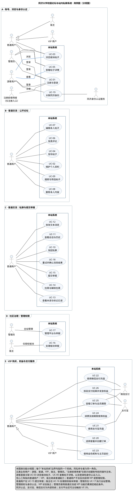

# 同济大学校园论坛与站内私聊系统软件需求规格说明书（SRS）

| 项目 | 内容 |
| --- | --- |
| 文档编号 | SRS-TJCF-001 |
| 文档版本 | 0.1（第 3 次课课前评审稿） |
| 日期 | 2026-11-23 |
| 课程阶段 | 第 2 次课后至第 3 次课前：项目需求规约 |
| 项目组 | 张启政（组长）、刘笑云、周禹佟、李灏文 |
| 需求来源 | [阶段调研报告 v1.1](../design/tongji-campus-forum-research-plan.md)及项目组确定的业务范围 |
| 配套模型 | [用例与场景说明](use-cases-and-scenarios.md)、[模型索引](../../models/requirements/README.md) |

## 1. 目的、范围与术语

本文规定系统对用户和外部服务应呈现的行为、业务约束及可验证的质量要求，供需求评审、后续设计和验收使用。文中的“应”“必须”表示验收要求。26 项功能需求使用 FR-01 至 FR-26 编号，对应 UC-01 至 UC-26；质量要求使用 NFR 编号，质量验收场景使用 NFC 编号。US 编号沿用阶段调研报告，FR/UC 与 US 的数字不要求相同。

系统面向同济校园的课程交流、项目组队和活动咨询，提供公开论坛、一对一文本私聊以及 VIP 个性化服务。业务链路包括“注册与浏览—同济身份关联—公开或私下交流”和“选择套餐—支付核验—会员权益生效”。

| 范围 | 内容 |
| --- | --- |
| 账号与论坛 | 注册登录、身份关联、个人资料、板块与校区标签、帖子、评论、搜索与本人内容管理 |
| 私聊 | 一对一会话、文本消息、历史、未读、发送重试、拉黑 |
| VIP | 套餐、支付宝及微信支付充值、订单查询、金色昵称、主页装扮、续费和到期 |
| 治理 | 举报、版主授权范围、管理员配置、账号限制及审计 |
| 本期范围外 | 群聊、音视频通话、文件私聊、推荐算法、用户间商品交易、平台钱包余额和提现 |

“游客用户”特指已创建本站账号、尚未关联同济身份的用户；“普通用户”指已关联同济身份的用户；“VIP”表示普通用户具有有效期内的付费展示权益。“公开帖子”指可供本站已登录用户浏览的公开内容。“支付成功”与“权益已生效”分别表示支付平台结果和本站会员发放结果，不以页面跳转代替服务端核验。

## 2. 参与者、权限与运行环境

### 2.1 参与者

| 类型 | 参与者 | 目标与边界 |
| --- | --- | --- |
| 主参与者 | 游客用户 | 浏览公开帖子列表、详情及其中的公开评论；办理同济身份关联；不开放搜索、发帖、评论、私聊、举报或充值 |
| 主参与者 | 普通用户 | 使用公开交流、搜索、私聊、个人资料管理、举报与 VIP 购买功能 |
| 主参与者 | VIP 用户 | 具备普通用户能力，并在有效期内使用金色昵称和主页装扮 |
| 主参与者 | 版主 | 具备普通用户能力；按授权板块处理公开内容和举报 |
| 主参与者 | 管理员 | 管理全站板块、角色授权、账号限制、举报分派、套餐与订单查询；私聊证据仅按举报授权访问 |
| 辅助建模参与者 | 注册前使用者（仅注册入口） | 表示创建本站账号前的操作主体；注册成功后成为游客，不是第六种业务权限角色 |
| 外部参与者 | 同济身份认证服务 | 校验学校身份并向本站提供可核验的认证结果 |
| 外部参与者 | 支付宝、微信支付 | 处理支付、返回通知和查单结果；在用户充值场景中为次参与者，在支付通知场景中可主动触发处理 |

身份关联、会员有效期与管理授权分别判定。普通用户与游客不是角色继承关系：关联身份会改变认证状态。VIP 用户和版主具有普通用户的交流能力；管理授权本身不授予 VIP。管理员同时使用普通交流或 VIP 功能时，仍须具备对应的认证和会员条件。所有操作还受账号限制约束。

游客、普通用户、VIP 用户、版主和管理员均可在登录后浏览板块帖子和查看公开帖子详情。游客在用例图中直接关联 UC-03、UC-05。普通用户可通过 UC-15 提交举报；UC-16 的授权板块举报处理属于版主，UC-17 的全站管理属于管理员。VIP、版主继承普通用户能力，不表示普通用户反向获得其专属权限。

### 2.2 运行与接入边界

用户通过电脑或手机浏览器访问本站。本站服务端负责身份、权限、订单和会员结果的可信判定，客户端只展示状态和提交操作意图。同济认证服务、支付宝和微信支付位于系统边界外。

外部接入应使用服务提供方授权的应用、商户配置及登记的回调地址，并遵循对应接口规范。外部服务联调需具备有效接入配置；本规约描述业务契约，不指定未经服务提供方确认的端点、协议参数或商户编号。接口故障必须按第 5、6 节约束处理。

## 3. 业务规则

| 编号 | 规则 |
| --- | --- |
| BR-01 | 注册与登录不自动产生同济认证状态。游客可浏览公开帖子和办理认证，直接请求受限接口也必须被拒绝。 |
| BR-02 | 同一同济身份至多关联一个本站账号，一个本站账号至多关联一个同济身份。并发和重复认证不得突破唯一性。 |
| BR-03 | 本站不收集学校登录密码；认证结果必须关联至本站发起会话，校验真实性、有效期和一次性请求上下文。 |
| BR-04 | 发帖、评论、搜索、私聊、举报和购买 VIP 需要同济认证及有效账号状态。修改本人资料不得改变认证、VIP 或管理权限。 |
| BR-05 | 同一对用户只有一个一对一会话；禁止自聊。任意一方拉黑后双方都不能发送新消息；拉黑不撤销原参与者对已有历史的访问权。 |
| BR-06 | 消息正文按 Unicode 码点计数，长度为 1—2000，纯空白正文不合法。服务端保存成功后才能确认发送成功。 |
| BR-07 | 消息去重以发送者和客户端请求标识为依据。同标识、同会话、同正文返回已有结果；同标识但内容冲突必须拒绝；客户端按消息编号去重展示。 |
| BR-08 | 私聊仅向会话参与者开放；举报证据仅含举报人选择且本人收到的相关消息。管理员只能读取获授权处理的举报证据，不能借举报读取整段无关会话。 |
| BR-09 | 版主只能管理被授权板块的公开内容。管理操作应记录操作人、对象、时间、理由及结果；修改权限以服务端授权为准。 |
| BR-10 | VIP 套餐的价格、币种与有效时长由服务端决定，创建订单时形成不可被后续套餐编辑改写的快照。订单绑定购买人及一个支付渠道。 |
| BR-11 | 会员发放依据为服务端核验后的成功交易。必须核对签名或可信响应、商户或应用标识、订单、金额、币种及交易状态；前端成功提示不能发放权益。 |
| BR-12 | 同一成功订单只增加一次会员时长；不同成功订单分别累加。新到期时间 = max（原到期时间，本次发放时间）+ 订单快照中的购买时长。 |
| BR-13 | 会员时间以服务端时间为准，持久化使用统一时间基准，界面使用北京时间展示。当前时间早于到期时间才享有 VIP 权益。 |
| BR-14 | VIP 到期后金色昵称和专属装扮停用，主页恢复普通展示；普通交流及独立管理授权保留。 |
| BR-15 | 关闭或取消支付与支付成功发生冲突时应主动查单，按可信平台结果处理。未确认成功不新增权益；已核验成功的订单不能被后到的未支付状态覆盖。 |
| BR-16 | 已隐藏或删除的内容不得继续出现在普通列表、搜索和详情中；举报处理记录与必要的审计信息应保留。 |

## 4. 功能需求与验收条件

各功能需求的前置条件、主流程、替代流程及后置条件见[用例与场景说明](use-cases-and-scenarios.md)。以下验收条件继承对应用户故事，并与第 3 节业务规则共同构成验收依据。

### FR-01 注册与登录

用例：UC-01；来源：US-01。

系统应提供本站账号注册、登录和退出能力。注册只产生游客身份，身份认证与本站登录分开处理。

- **Given**：注册标识可用且资料满足校验。
- **When**：完成注册并登录。
- **Then**：创建唯一账号并赋予游客身份，重复注册被拒绝，登录成功不会自动获得同济认证状态。

### FR-02 维护个人资料

用例：UC-02；来源：US-02。

系统应允许普通用户修改本人昵称与校区资料，用户资料写入不得改变认证、会员或管理授权。

- **Given**：用户已关联同济身份。
- **When**：保存本人昵称和校区。
- **Then**：刷新后显示新资料，修改资料不能改变认证状态、会员期限或管理权限。

### FR-03 浏览板块帖子

用例：UC-03；来源：US-03。

系统应向已登录账号展示指定板块的公开帖子列表，并使游客能够进入帖子详情。

- **Given**：游客已登录。
- **When**：选择课程组队、学习交流、校园生活或活动信息板块。
- **Then**：显示对应公开帖子列表，发帖入口引导身份认证。

### FR-04 发布帖子

用例：UC-04；来源：US-04。

系统应允许普通用户向有效板块发布包含标题、正文及校区标签的帖子，并记录作者与发布时间。

- **Given**：用户已认证且账号状态正常。
- **When**：提交有效标题、正文、板块和校区标签。
- **Then**：创建帖子并显示作者，空内容和游客提交均被服务端拒绝。

### FR-05 查看帖子详情

用例：UC-05；来源：US-05。

系统应展示可见帖子的正文、作者、板块、校区及公开评论，同时按当前权限提供操作入口。

- **Given**：帖子公开可见。
- **When**：打开详情。
- **Then**：显示标题、正文、作者、板块、校区和公开评论，游客不能提交评论或发起私聊。

### FR-06 发表评论

用例：UC-06；来源：US-06。

系统应允许普通用户对允许评论的帖子提交非空评论，记录评论所属帖子、作者和时间。

- **Given**：用户已认证且帖子允许评论。
- **When**：提交有效评论。
- **Then**：评论显示在该帖下并保留作者和时间，空评论及游客评论请求被拒绝。

### FR-07 编辑本人帖子

用例：UC-07；来源：US-07。

系统应允许具备交流权限的作者编辑本人帖子，拒绝其他普通用户冒用作者身份修改。

- **Given**：用户已认证且是帖子作者。
- **When**：保存修改。
- **Then**：刷新后显示新内容，其他普通用户不能编辑该帖。

### FR-08 删除本人内容

用例：UC-08；来源：US-08。

系统应允许具备交流权限的作者删除本人帖子或评论；被删除内容不再对普通浏览者展示。

- **Given**：用户已认证且是作者。
- **When**：确认删除。
- **Then**：内容在普通浏览中隐藏，他人删除请求被拒绝，治理操作按管理权限处理。

### FR-09 搜索与筛选帖子

用例：UC-09；来源：US-09。

系统应允许普通用户按标题或正文关键词搜索，并同时按校区筛选可见帖子。

- **Given**：用户已认证且存在不同关键词和校区的帖子。
- **When**：输入关键词并选择校区。
- **Then**：返回同时满足标题或正文关键词与校区条件的可见帖子，无结果时提示。

### FR-10 发起私聊

用例：UC-10；来源：US-10。

系统应在双方已认证、账号正常且未拉黑时创建或返回双方唯一的一对一会话。

- **Given**：双方已关联同济身份、账号正常且不存在拉黑关系。
- **When**：点击作者私聊入口。
- **Then**：打开双方唯一会话，重复点击返回同一会话，游客及本人自聊请求被拒绝。

### FR-11 查看会话与历史

用例：UC-11；来源：US-11。

系统应向会话参与者展示本人的会话列表及已持久化消息，支持再次登录后继续读取。

- **Given**：用户已认证且参与相应会话。
- **When**：打开列表和会话。
- **Then**：显示本人会话及已保存消息，再次登录仍可读取，其他用户不能访问。

### FR-12 收发文本消息

用例：UC-12；来源：US-12。

系统应允许有权交流的会话参与者收发文本消息，持久化后确认保存结果，并向在线接收者投递。

- **Given**：双方身份和账号状态有效、具备会话权限且未拉黑。
- **When**：发送 1—2000 字符的非空文本。
- **Then**：服务端保存后确认成功，在线接收者可见消息，保存失败时显示失败。

### FR-13 查看未读与标记已读

用例：UC-13；来源：US-13。

系统应按接收者维护未读信息，依据用户确认读取到的消息更新已读范围。

- **Given**：用户收到未读消息。
- **When**：查看会话列表。
- **Then**：显示未读数，进入会话并确认读取至指定消息后，已读范围内消息不再计数，新消息继续计数。

### FR-14 拉黑与解除拉黑

用例：UC-14；来源：US-14。

系统应允许普通用户拉黑其他账号。任意一方存在有效拉黑关系时拒绝双方的新消息；全部相关拉黑解除后恢复发送条件。

- **Given**：双方存在联系。
- **When**：拉黑对方。
- **Then**：服务端拒绝双方后续发送请求，历史仍可由原参与者查看，解除后恢复发送权限。

### FR-15 提交举报

用例：UC-15；来源：US-15。

系统应允许普通用户举报可访问的公开内容，或提交本人收到的指定私聊消息作为举报证据。

- **Given**：用户能访问公开举报对象，或是私聊举报对象的接收者。
- **When**：提交对象和原因。
- **Then**：生成举报编号与状态，私聊证据仅含举报人选取的相关消息。

### FR-16 处理板块举报

用例：UC-16；来源：US-16。

系统应允许版主在授权板块内查看和处理公开内容举报，并记录处置理由及操作人。

- **Given**：版主有该板块管理权限。
- **When**：处理举报并填写理由。
- **Then**：保存结果及操作记录，跨板块管理请求被拒绝。

### FR-17 管理平台与举报

用例：UC-17；来源：US-17。

系统应允许管理员管理板块、版主范围、账号限制、举报分派、VIP 套餐及充值订单查询，并记录管理审计。

- **Given**：管理员已登录。
- **When**：管理板块、版主范围、账号限制、举报分派或套餐。
- **Then**：保存操作人、对象、时间及理由，套餐变更不改写历史订单快照，无管理授权的普通用户和 VIP 用户不能执行管理操作。

### FR-18 重试并确认消息结果

用例：UC-18；来源：US-18。

系统应根据发送者及客户端请求标识识别消息重试，返回同一消息结果；标识相同而会话或正文不同的请求应被拒绝。

- **Given**：消息带固定客户端请求标识。
- **When**：网络恢复后用同一标识重试。
- **Then**：返回同一已保存消息，历史只出现一次，未成功保存的请求可再次提交。

### FR-19 关联同济身份

用例：UC-19；来源：US-21。

系统应通过同济身份认证服务验证用户身份，将校方身份唯一关联至发起认证的本站账号，并授予普通用户能力。

- **Given**：游客已登录且所用同济身份未绑定其他账号。
- **When**：完成学校认证且服务端验证成功。
- **Then**：建立唯一身份关联并开放普通用户功能，取消、伪造或重复绑定均不能升级权限。

### FR-20 选择套餐并创建订单

用例：UC-20；来源：US-22。

系统应向普通用户展示在售 VIP 套餐及支付渠道，按服务端价格和时长为当前账号生成订单快照。

- **Given**：用户已认证且账号正常。
- **When**：选择在售套餐及支付宝或微信支付。
- **Then**：服务端创建属于本人的订单并保存套餐价格和时长快照，游客请求及客户端价格篡改不能生成有效充值订单。

### FR-21 使用支付宝充值

用例：UC-21；来源：US-23。

系统应通过支付宝处理本人订单的 VIP 充值，并仅在服务端核验成功支付后发放相应权益。

- **Given**：本人订单绑定支付宝渠道且可支付。
- **When**：完成支付宝支付并由服务端核验成功。
- **Then**：订单更新为支付成功且会员权益发放一次，取消支付时保留原权益。

### FR-22 使用微信支付充值

用例：UC-22；来源：US-24。

系统应通过微信支付处理本人订单的 VIP 充值，对通知进行验签、解密和业务核对后发放权益。

- **Given**：本人订单绑定微信支付渠道且可支付。
- **When**：完成微信支付并由服务端验签、解密及业务校验成功。
- **Then**：订单更新为支付成功且会员权益发放一次，超时未支付时保留原权益。

### FR-23 使用金色昵称与主页装扮

用例：UC-23；来源：US-25。

系统应为有效 VIP 在帖子、评论及个人主页显示统一金色昵称，并允许选择和保存平台提供的主页装扮。

- **Given**：会员处于有效期内。
- **When**：查看帖子、评论和个人主页，或保存平台提供的主页装扮。
- **Then**：昵称统一显示为 VIP 金色，主页呈现所选装扮，普通用户直接请求专属装扮设置被拒绝。

### FR-24 续费及按期限使用权益

用例：UC-24；来源：US-26。

系统应按成功订单累加会员期限，并以服务端当前时间判定权益有效性；到期不影响普通交流或独立管理授权。

- **Given**：账号已有会员期限。
- **When**：新续费订单支付成功。
- **Then**：从现有到期时间与发放时间的较晚者累加购买时长，并发的不同成功订单分别累加；到期后金色昵称和专属装扮停用，普通交流及独立管理权限保留。

### FR-25 查看订单与会员期限

用例：UC-25；来源：US-27。

系统应允许用户查看本人充值订单及会员期限，通知延迟时通过服务端查单核对支付结果。

- **Given**：用户拥有充值订单。
- **When**：查看订单详情或刷新支付结果。
- **Then**：显示本人订单的渠道、金额、支付及权益状态，通知延迟时服务端通过查单核对，不能通过修改订单编号读取他人订单。

### FR-26 核验支付结果并发放权益

用例：UC-26；来源：US-28。

系统应统一处理支付通知和查单确认，保证每个成功订单仅发放一次权益，重复、并发及中断恢复均保持结果一致。

- **Given**：平台发送支付通知或服务端查单确认结果。
- **When**：同一订单被重复或并发处理，或一次处理在中途失败后重试。
- **Then**：通过验签及商户、订单、金额、币种核对后仅发放一次权益，失败重试恢复一致状态，伪造或不匹配结果被拒绝。

## 5. 非功能需求与质量验收场景

### NFR-01 安全与权限隔离（来源 US-19）

系统应在服务端对身份、账号状态、资源归属、会话参与关系、管理范围和会员期限执行授权校验；不以隐藏按钮或客户端角色字段作为安全边界。对外通信使用 HTTPS，日志不得输出学校密码、完整认证凭据、支付密钥或完整私聊正文。

**NFC-01：权限隔离验收场景**

- **Given**：准备游客、两名互不隶属的普通用户、VIP、不同板块版主和管理员账号，并建立属于不同用户的会话和订单。
- **When**：分别尝试游客发帖、评论、搜索、私聊或充值，读取他人会话和订单，篡改客户端角色或会员期限，跨板块管理，以及读取未授权举报证据。
- **Then**：所有越权请求均被服务端拒绝，不产生业务写入，不返回受保护正文或订单详情；合法对照请求成功，拒绝和管理操作有不含敏感正文的记录。

验收通过条件：上述越权场景拒绝率为 100%，合法对照请求不被错误拒绝。认证伪造及支付签名、金额篡改还须满足 UC-19、UC-26 的异常流程。

### NFR-02 消息性能与可靠性（来源 US-20、US-18）

在同一测试网络中，20 个已认证模拟用户在线，合计每秒发送 5 条合法文本消息、持续 5 分钟。正常负载共提交 1500 条具有不同请求标识的消息；端到端显示延迟 P95 不超过 1 秒，消息应完整保存且只出现一次。

**NFC-02：负载与消息一致性验收场景**

- **Given**：测试账号均可交流、无拉黑且接收端在线；记录客户端、服务端、数据库、网络及部署配置。使用同一测试控制器单调时钟记录发送与接收显示确认，避免客户端时钟偏差。
- **When**：运行上述 5 分钟负载，按唯一消息标识统计延迟，并核对服务端保存结果和接收端展示结果。以升序第 ceil(0.95 × N) 个延迟作为 P95。
- **Then**：1500 条消息全部可核对，持久化和接收显示均无重复、无缺失，P95 ≤ 1 秒；失败或超时的消息不得从成功率统计中排除，也不得仅用成功样本宣称验收通过。

重试恢复单独验证：保存成功但确认丢失时，使用原请求标识再次发送应返回原消息；保存失败时重试应最终只形成一条消息；接收端断线后应通过历史同步补齐。故障注入样本单独报告，不与正常网络下的延迟指标混算。

### NFR-03 可用性与故障反馈（由 US-21、US-23、US-24、US-27、US-28 的异常场景细化）

外部认证或支付服务故障不得被展示为认证成功、支付成功或权益已生效。订单及消息应区分处理中、成功和失败，用户可查看已有结果并发起合理重试。前端重复点击与后端重试不得造成身份、消息或会员重复生效。

**NFC-03：外部故障与恢复验收场景**

- **Given**：分别模拟认证服务不可达、支付接口超时、通知延迟以及权益保存中断，准备已有帖子、会话和订单。
- **When**：用户执行相应业务，随后恢复外部服务并重新认证、查单或触发结果处理。
- **Then**：失败阶段有明确状态及可执行的后续入口，不误授认证或会员权限，不损坏已有结果；恢复后成功订单仅发放一次权益。认证或支付故障期间，本站可见帖子的浏览仍可完成。

本项约束外部故障下的可恢复行为，不将第三方系统的可用率作为本站可保证的服务指标。

## 6. 外部接口与数据要求

### 6.1 外部接口业务契约

| 接口 | 输入与输出 | 必须满足的约束 |
| --- | --- | --- |
| 同济身份认证 | 输入为认证发起上下文及校方要求的接入参数；输出为可验证的身份结果 | 本站不接收学校密码；验证请求关联和凭据有效性；取消、过期、伪造、重复绑定不升级身份 |
| 支付宝 | 提交商户订单、金额及支付参数；接收交易通知，支持查单和关闭订单 | 订单绑定渠道；验证平台签名或可信响应及业务字段；成功结果统一进入 UC-26 |
| 微信支付 | 提交商户订单与支付参数；接收通知，支持查单和关闭订单 | 通知验签、解密与业务字段核对；密钥和证书仅存运行配置；成功结果统一进入 UC-26 |

账号、应用、商户及证书配置由运行环境提供，不写入仓库正文。测试应区分模拟环境、官方测试环境及经授权的实际接入环境；测试记录注明实际使用的环境和结果。

### 6.2 业务数据与一致性

| 数据 | 必备信息与约束 |
| --- | --- |
| 账号及身份 | 本站账号标识、昵称、校区、账号状态、唯一身份关联；身份信息按业务所需最小范围保存 |
| 帖子与评论 | 作者、正文、所属板块或帖子、时间、可见状态；帖子包含标题与校区标签 |
| 会话与消息 | 两名会话参与者、消息标识、发送者、正文、请求标识、服务端时间及已读范围；禁止非参与者读取 |
| 举报与审计 | 举报人、对象、所选证据、处理范围、状态、处理理由和操作记录；限制证据访问 |
| VIP 套餐及订单 | 套餐标识、订单快照、购买人、渠道、金额、币种、支付状态、平台交易关联和权益发放结果 |
| 会员权益 | 生效及到期时间、权益发放订单与所选装扮；不同订单续费不丢失，同一订单不重复累加 |

支付确认与权益发放应有一致的可恢复结果，不能向用户报告不存在的权益。涉及并发的身份关联、会话建立、消息保存与会员续费均以服务端最终保存结果为准。

## 7. 用例模型与验收组织

[用例图源文件](../../models/requirements/use-cases.puml)定义 26 个功能用例，按账号与访问、公开论坛、私聊与提交举报、社区治理、VIP 与支付五个视图展示。各视图的“本站系统”均指同一系统，同名参与者代表同一角色；治理视图仅绘出版主与管理员的管理关联。非功能要求通过 NFC-01 至 NFC-03 进行质量验收，不绘制成普通业务角色主动操作的椭圆。

[配套场景文档](use-cases-and-scenarios.md)包含完整用例目录，以及身份关联、文本消息、支付宝充值三个细化用例；微信支付场景沿用充值主流程并明确渠道差异。三张活动图分别表达身份关联、消息处理和双渠道充值。

需求验收以功能条目的 Given / When / Then、场景替代流程和非功能指标为依据。至少覆盖成功、权限拒绝、外部失败、重复请求与并发处理；结果应能够定位到 FR、UC 或 NFR/NFC 编号。本文件中的编号关联用于组织本次需求评审。

## 8. 约束与需求风险

| 约束或风险 | 需求层处理要求 |
| --- | --- |
| 校方及支付服务接入资格、配置或网络异常 | 按授权接口接入；失败时不误授身份或权益；以可信查询结果恢复 |
| 客户端参数篡改 | 服务端确定身份、授权、价格、订单购买人及会员期限 |
| 消息断线、重复发送及投递中断 | 请求去重、保存确认和历史补齐；保留用户可辨认的发送结果 |
| 支付重复通知、并发续费和部分失败 | 核验支付、单订单幂等及不同订单时长累加；查单与重试恢复一致结果 |
| 隐私与治理权限冲突 | 会话参与者隔离；管理员只访问处理举报所需且获授权的证据 |
| 范围扩张影响课程增量交付 | 保持第 1 节范围，沿用账号论坛、可靠私聊、会员治理三个增量划分 |

本阶段规定业务可观察行为，不规定数据库产品、应用框架、具体 API 路径或内部类结构。

## 9. 依据、AI 使用与版本记录

课程依据：《第02课-需求调研讨论》第 1 页；《第03课-学生讲解项目需求》第 1 页；《软件工程课程设计要求-版本2》第 2—5 页。项目依据为[阶段调研报告 v1.1](../design/tongji-campus-forum-research-plan.md)及其中列明的项目业务说明和公开资料。

本文及配套模型由 OpenAI Codex 辅助整理和生成，AI 参与范围包括需求措辞、用例与活动图源文件、验收场景和文档一致性检查。按本版新增正文与图源统计，AI 辅助覆盖比例约为 100%；业务范围沿用项目组提供的用户分类、同济身份认证、支付渠道与 VIP 权益。需求确认及合并放行采用人工评审，意见与修改记录以对应 PR 的实际记录为依据。本版作为第 3 次课需求评审输入。

| 版本 | 日期 | 内容 |
| --- | --- | --- |
| 0.1 | 2026-11-23 | 汇编 26 项功能需求、3 项非功能需求、用例模型、细化场景、外部接口业务契约及验收条件，形成课前评审稿 |
