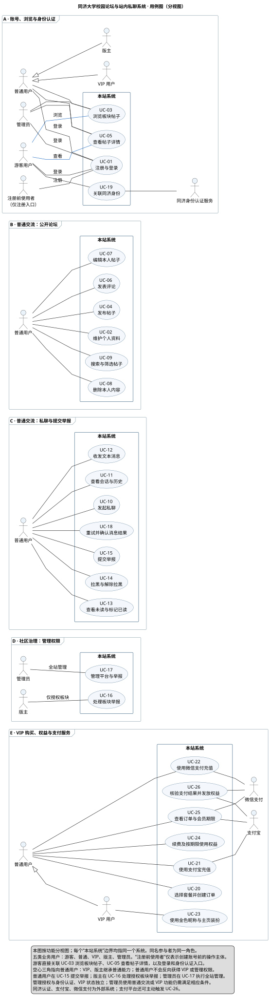
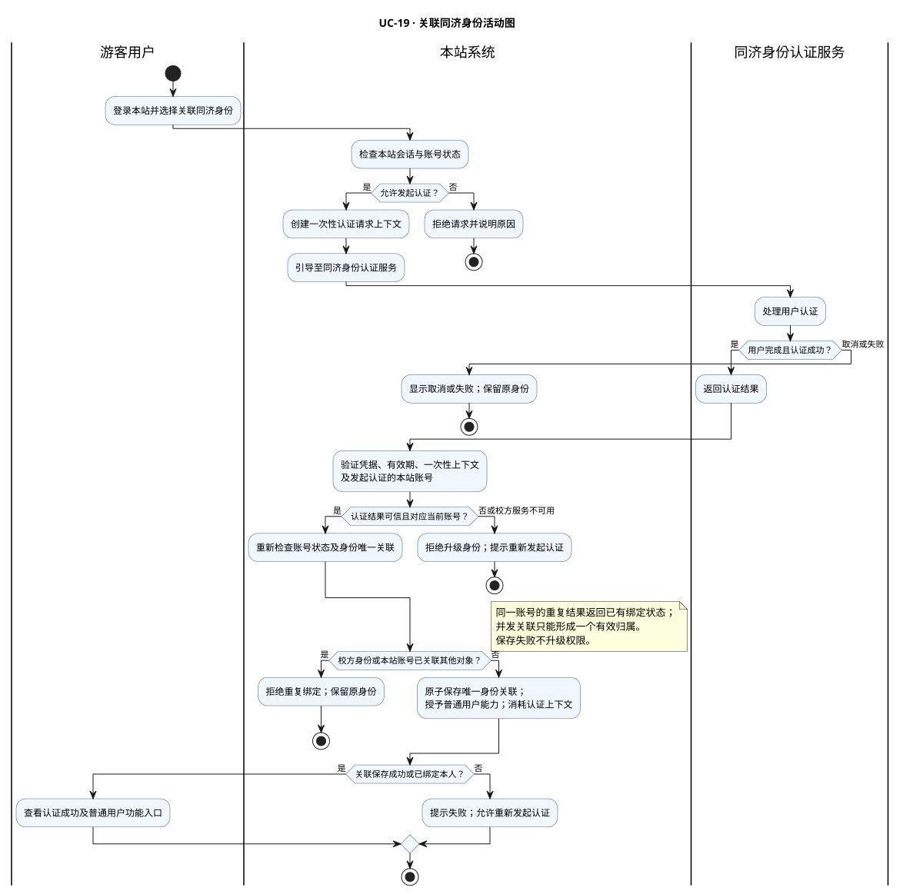
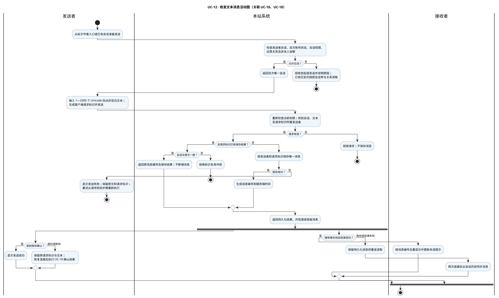
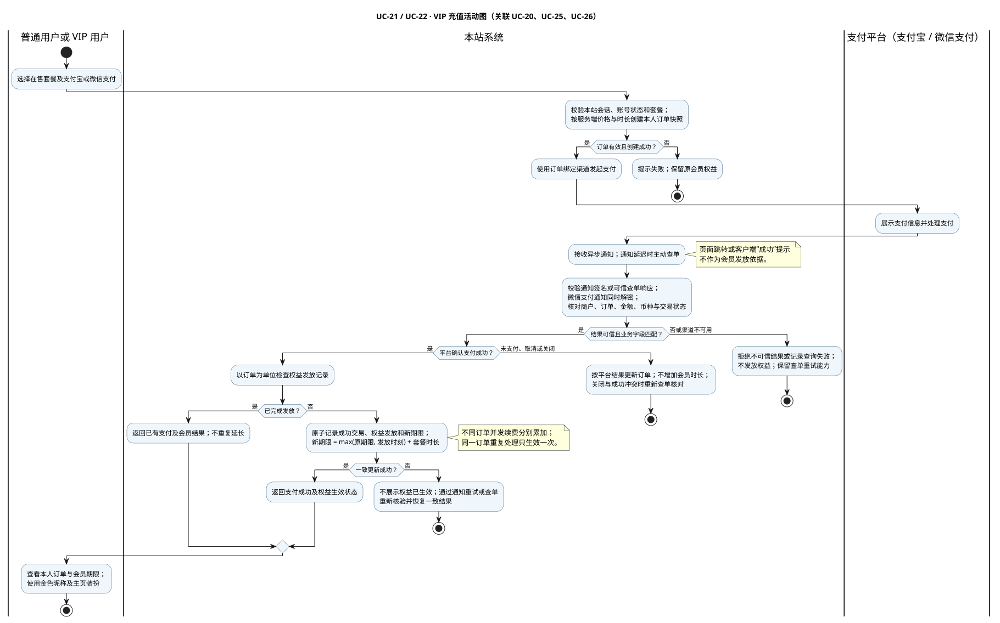

# 同济大学校园论坛与站内私聊系统用例与场景说明

| 项目 | 内容 |
| --- | --- |
| 版本与日期 | 0.1，2026-11-23 |
| 对应阶段 | 第 3 次课课前需求评审 |
| 配套规约 | [软件需求规格说明书（SRS）](software-requirements-specification.md) |
| 场景依据 | [阶段调研报告](../design/tongji-campus-forum-research-plan.md)中的 US-01 至 US-28 |
| 内容 | 26 个功能用例、完整场景目录、3 个细化用例与活动图、微信支付渠道差异 |

## 1. 模型说明

系统边界为“同济大学校园论坛与站内私聊系统”。五类业务用户为游客、普通用户、VIP 用户、版主和管理员；同济身份认证、支付宝和微信支付位于边界外。“注册前使用者”仅表示创建账号前的操作主体，只关联 UC-01 的注册入口；注册成功后成为游客，不增加业务权限角色。五类已有账号用户通过 UC-01 的登录路径进入本站。

用例图分为账号与访问、公开论坛、私聊与提交举报、社区治理、VIP 与支付五个视图；每个“本站系统”边界表示同一个系统，同名参与者表示同一角色。游客直接连接 UC-03 浏览板块帖子、UC-05 查看帖子详情。普通用户的 UC-15 是提交举报；治理视图中的 UC-16 仅由版主处理授权板块举报，UC-17 由管理员执行全站管理。

普通用户不继承“未认证游客”的身份条件。VIP 用户和版主具备普通用户能力；会员状态与管理授权独立，管理员使用普通交流或 VIP 能力时满足相应认证和会员条件。支付平台在用户充值场景中提供协作服务，在 UC-26 中通过通知主动触发支付结果处理。

[PlantUML 源文件](../../models/requirements/use-cases.puml)。关联线表示参与关系，不表示页面跳转、调用次序或必须同时执行的业务。安全、性能和可用性是跨用例约束，详见 SRS 的 NFR-01 至 NFR-03。

## 2. 完整用例与场景目录

每个用例对应同编号 FR 条目；US 列定位到调研报告中的用户故事。各用例同时遵循 SRS 的 BR-01 至 BR-16。表中的失败结果均不得造成超越当前授权的业务写入。

| 用例 / 需求 / 来源 | 参与者 | 前置条件与触发 | 主成功场景 | 替代或异常场景 | 后置条件 |
| --- | --- | --- | --- | --- | --- |
| UC-01 注册与登录；FR-01；US-01 | 注册前使用者（注册）；五类已有账号用户（登录） | 申请注册或提交本站登录凭据 | 校验注册资料并创建唯一游客账号；已有账号通过校验后进入本站 | 标识重复、资料无效或凭据错误时拒绝；退出后失效当前会话 | 新账号为游客；登录不更改已有认证、VIP 或管理授权 |
| UC-02 维护个人资料；FR-02；US-02 | 普通用户 | 账号正常，打开本人资料页 | 读取本人资料→修改昵称及校区→校验保存→刷新展示 | 提交他人账号或认证、会员、角色字段时拒绝相应越权修改 | 仅本人可编辑资料发生变更 |
| UC-03 浏览板块帖子；FR-03；US-03 | 已登录账号（含游客） | 选择有效板块 | 按板块读取可见帖子→展示列表→提供详情入口 | 空板块展示空状态；无效板块说明不可访问；隐藏帖子不进入结果 | 展示指定板块当前可见列表 |
| UC-04 发布帖子；FR-04；US-04 | 普通用户 | 已认证且账号正常，提交新帖 | 填写标题、正文、有效板块和校区→服务端校验→保存→返回详情 | 游客、受限账号、空标题/正文或无效板块被拒绝，不创建帖子 | 创建唯一帖子，保留作者和时间 |
| UC-05 查看帖子详情；FR-05；US-05 | 已登录账号（含游客） | 请求查看公开帖子 | 检查可见性→展示正文、作者、板块、校区和公开评论 | 已删除、隐藏或不存在时说明不可访问；游客不获得评论和私聊权限 | 返回有权浏览的内容，无越权数据 |
| UC-06 发表评论；FR-06；US-06 | 普通用户 | 已认证、账号正常且目标帖子允许评论 | 填写评论→检查帖子和权限→保存评论→展示作者和时间 | 纯空白、游客写入、帖子关闭或不可见时拒绝 | 目标帖子增加一条合法评论 |
| UC-07 编辑本人帖子；FR-07；US-07 | 普通用户（帖子作者） | 打开本人可编辑帖子并保存修改 | 检查所有权与账号状态→校验新内容→更新→刷新详情 | 非作者、无效内容或受限账号被拒绝 | 本人帖子内容更新，作者归属不变 |
| UC-08 删除本人内容；FR-08；US-08 | 普通用户（内容作者） | 确认删除本人帖子或评论 | 检查权限及所有权→更新可见状态→从普通浏览中隐藏 | 他人删除请求被拒绝；重复删除不恢复内容 | 列表、搜索和普通详情不再展示删除对象；治理记录保留 |
| UC-09 搜索与筛选帖子；FR-09；US-09 | 普通用户 | 已认证且账号正常，输入关键词和校区 | 校验查询→匹配标题或正文关键词→与校区条件取交集→展示可见结果 | 游客查询被拒绝；无结果显示空状态；隐藏内容不泄露 | 只返回同时满足条件且可见的帖子 |
| UC-10 发起私聊；FR-10；US-10 | 普通用户（双方） | 从另一用户的帖子作者入口请求私聊 | 检查双方认证、状态和拉黑关系→创建或取得双方唯一会话→打开会话 | 自聊、游客、账号受限或拉黑时拒绝建立/发送；并发重复请求返回同一会话 | 双方共用一个会话标识；不会产生重复会话 |
| UC-11 查看会话与历史；FR-11；US-11 | 普通用户（会话参与者） | 打开会话列表或已有会话 | 确认本人身份与参与关系→读取本人会话及消息→展示历史 | 非参与者或失效会话被拒绝；拉黑不删除原参与者历史 | 跨次登录可继续读取保存的历史，其他用户不可访问 |
| UC-12 收发文本消息；FR-12；US-12 | 普通用户（发送者、接收者） | 双方有权交流，发送合法文本 | 校验身份、成员关系和正文→保存唯一消息→确认发送→投递或供历史读取 | 无权限或非法文本拒绝；保存失败说明失败；离线接收和确认丢失按细化场景处理 | 成功消息保存一次，在线接收者可见，离线接收者可补齐 |
| UC-13 查看未读与标记已读；FR-13；US-13 | 普通用户 | 查看会话列表或确认读取到指定消息 | 按接收者统计未读→展示数量→验证已读位置属于该会话→推进已读范围 | 他人会话或无效消息位置被拒绝；重复已读确认不回退；并发新消息保留未读 | 已确认范围内不再计未读，新消息继续计数 |
| UC-14 拉黑与解除拉黑；FR-14；US-14 | 普通用户 | 对其他账号执行拉黑或解除 | 保存或撤销本人发起的拉黑→发送时重新检查双方拉黑关系 | 不能通过解除本人拉黑撤销对方的拉黑；历史不会因拉黑被删除 | 任一方仍拉黑则禁止新消息；双方均解除后恢复发送条件 |
| UC-15 提交举报；FR-15；US-15 | 普通用户 | 选中可见公开内容或本人收到的私聊消息并填写原因 | 验证举报资格→保存对象、原因与选定证据→返回举报编号及状态 | 无权访问、非本人收到的消息或无效对象被拒绝；不自动附带整段会话 | 生成可追踪的举报及最小必要证据 |
| UC-16 处理板块举报；FR-16；US-16 | 版主 | 处理本人授权板块的公开内容举报 | 检查管理范围→查看相关公开内容→填写理由并处置→记录结果 | 跨板块或私聊举报不向版主开放；缺少处置理由不得完成处理 | 举报状态和公开内容处置一致，操作可审计 |
| UC-17 管理平台与举报；FR-17；US-17 | 管理员 | 进入获授权的平台管理功能 | 校验授权→管理板块、版主范围、账号限制、举报分派、套餐或查询订单→记录操作 | 普通/VIP 用户请求管理功能被拒绝；私聊举报只展示获授权证据；套餐修改不改写历史订单 | 配置或处置保存并可审计；查询不变更交易事实 |
| UC-18 重试并确认消息结果；FR-18；US-18 | 普通用户（发送者） | 发送结果不明或失败，使用原标识重试 | 重新校验当前权限→按发送者及标识查找→返回已保存结果或保存新消息 | 同标识不同会话/正文拒绝；权限已撤销则拒绝新发送；不得增加重复消息 | 恢复确定的发送结果，原消息只保留一条 |
| UC-19 关联同济身份；FR-19；US-21 | 游客用户；同济身份认证服务 | 本站会话有效，发起身份关联 | 建立认证上下文→跳转校方认证→验证结果→保存唯一关联→开放普通能力 | 取消、超时、伪造、会话不匹配、并发重复绑定或保存失败不误授权限 | 成功得到唯一身份关联；失败保留原身份 |
| UC-20 选择套餐并创建订单；FR-20；US-22 | 普通用户或 VIP 用户 | 账号正常，选择在售套餐和支付渠道 | 展示权益、价格和时长→校验套餐→创建本人订单及快照→返回渠道支付入口 | 游客、下架套餐或篡改价格/购买人被拒绝；调用失败不标记支付成功 | 形成绑定购买人、渠道、金额和时长的订单 |
| UC-21 使用支付宝充值；FR-21；US-23 | 普通用户或 VIP 用户；支付宝 | 本人支付宝订单可支付，确认充值 | 调用支付宝→用户支付→服务端核验通知或查单→统一发放→展示会员期限 | 取消、超时、不可信回调、渠道故障或发放失败按细化场景处理 | 核验成功订单发放一次；其他状态不新增权益 |
| UC-22 使用微信支付充值；FR-22；US-24 | 普通用户或 VIP 用户；微信支付 | 本人微信订单可支付，确认充值 | 调用微信支付→用户支付→通知验签解密或可信查单→核对业务→统一发放 | 渠道不匹配、验签或解密失败拒绝；取消、超时和重复处理与 UC-21 一致 | 核验成功订单发放一次；其他状态不新增权益 |
| UC-23 使用金色昵称与主页装扮；FR-23；US-25 | VIP 用户 | 会员有效，查看展示区域或选择装扮 | 服务端校验期限→显示金色昵称→读取可用装扮→保存本人选择→展示主页 | 普通用户或过期 VIP 请求专属装扮被拒绝；客户端伪造会员不生效 | 帖子、评论、主页统一展示金色昵称及所选有效装扮 |
| UC-24 续费及按期限使用权益；FR-24；US-26 | 普通用户（含有效或已到期 VIP） | 成功续费订单到达，或访问时检查会员期限 | 核验成功订单→从较晚的原期限/发放时刻增加时长；每次权益访问检查到期 | 重复订单不累加；并发不同订单分别累加；到期自动按普通展示处理 | 有效期和展示一致；普通交流及独立管理权限保留 |
| UC-25 查看订单与会员期限；FR-25；US-27 | 普通用户；支付宝或微信支付（查单时） | 请求查看本人订单或刷新结果 | 验证归属→显示渠道、金额、支付及发放状态→必要时服务端查单→刷新期限 | 读取他人订单被拒绝；外部失败显示可重试状态，不冒充成功 | 用户得到本人订单与会员的一致状态 |
| UC-26 核验支付结果并发放权益；FR-26；US-28 | 支付平台（通知触发）；购买者为受益人 | 收到支付通知或可信查单结果 | 核验签名/可信响应和业务字段→确认成功→查幂等记录→一致保存交易与权益 | 伪造或不匹配拒绝；重复处理返回原结果；中断后重试；关闭竞态查单 | 同一订单仅发放一次，不同订单时长各自保留 |

## 3. 细化用例一：UC-19 关联同济身份

### 3.1 用例卡

| 项目 | 内容 |
| --- | --- |
| 目标 | 将可信同济身份与本站账号唯一关联，使游客获得普通用户交流资格 |
| 主 / 次参与者 | 游客用户 / 同济身份认证服务 |
| 需求与来源 | FR-19；US-21；BR-01 至 BR-04；NFR-01、NFR-03 |
| 触发 | 用户在本站选择“关联同济身份” |
| 前置条件 | 本站会话有效、账号状态允许认证；用户在校方认证页面处理学校凭据 |
| 成功后置条件 | 唯一身份关联保存，普通交流入口开放，后续接口使用服务端认证状态授权 |
| 最小保证 | 未保存有效关联就不升级权限，不保存学校密码，不改写其他账号的身份归属 |

### 3.2 主成功流程

1. 游客从本站认证入口发起关联。
2. 本站检查当前会话和账号状态，创建与发起账号关联的一次性认证上下文。
3. 本站引导用户进入同济身份认证服务。
4. 用户在校方页面完成认证；校方返回可验证的认证结果。
5. 本站检查结果真实性、有效期、认证上下文和当前账号的对应关系。
6. 本站重新检查账号状态，确认校方身份和本站账号均符合唯一关联规则。
7. 本站原子保存身份关联和认证状态，并消耗本次认证上下文。
8. 本站展示认证成功；用户进入普通用户功能，后续发帖、评论和私聊请求按新身份授权。

### 3.3 替代与异常流程

| 分支 | 对应步骤 | 处理与结束条件 |
| --- | --- | --- |
| A1 会话失效或账号受限 | 2、5、6 | 拒绝此次关联，要求以有效本站会话重新发起；不将结果关联到其他账号 |
| A2 取消或校方认证失败 | 4 | 返回取消或失败信息，保持原身份，用户可重新发起 |
| A3 凭据伪造、过期或上下文不匹配 | 5 | 拒绝认证结果并记录脱敏原因，不升级权限 |
| A4 校方服务不可达 | 3、5 | 明确提示认证未成功，保留游客浏览能力，允许恢复后重新发起 |
| A5 身份已关联其他账号 | 6 | 拒绝绑定；不替换、转移或暴露另一账号的身份资料 |
| A6 同一账号重复完成或并发请求 | 6、7 | 已绑定本人时返回已有绑定状态；并发竞争只产生一个有效归属；重复结果不增加权限或关联记录 |
| A7 保存失败 | 7 | 本次不升级身份；恢复后重新发起或查询当前本人绑定结果 |

### 3.4 验收场景

| 编号 | Given | When | Then |
| --- | --- | --- | --- |
| SC-19-01 | 游客账号正常，身份尚未绑定 | 完成真实有效的认证流程 | 唯一关联保存，普通功能开放，登录本身不曾提前升级身份 |
| SC-19-02 | 身份已绑定另一个本站账号 | 当前游客尝试关联该身份 | 绑定被拒绝，原归属不变，当前账号仍无普通权限 |
| SC-19-03 | 有过期、伪造或属于另一会话的认证结果 | 提交至认证结果处理入口 | 拒绝且不升级权限，不返回其他账号资料 |
| SC-19-04 | 两个账号同时尝试绑定同一身份 | 并发完成认证 | 至多一个账号成功，最终只有一个身份归属 |
| SC-19-05 | 用户取消认证或校方不可达 | 返回本站 | 显示相应状态，游客仍可浏览帖子，无新增交流权限 |

### 3.5 活动图

[PlantUML 源文件](../../models/requirements/activity-identity.puml)。

## 4. 细化用例二：UC-12 收发文本消息

### 4.1 用例卡

| 项目 | 内容 |
| --- | --- |
| 目标 | 向另一名已认证用户发送可持久读取的一对一文本消息，并得到明确结果 |
| 主参与者 | 发送者与接收者，均为普通用户或同时具备普通用户能力的账号 |
| 需求与来源 | FR-12；US-12；关联 UC-10、UC-11、UC-13、UC-18；BR-05 至 BR-07；NFR-01、NFR-02 |
| 触发 | 发送者在本人会话中提交文本 |
| 前置条件 | 双方认证有效、账号正常、非本人自聊、发送者属于会话且双方未拉黑；接收者可离线 |
| 成功后置条件 | 消息保存一次，发送者可确认消息结果；在线接收者可见，离线接收者可从历史补齐 |
| 最小保证 | 不向非参与者泄露正文；未保存不确认发送成功；重试不新增重复消息 |

### 4.2 主成功流程

1. 用户从帖子作者入口执行 UC-10，或从 UC-11 的会话列表进入已有会话；系统返回双方唯一会话。
2. 发送者输入 1—2000 个 Unicode 码点且非纯空白的文本。
3. 客户端为本次消息生成固定请求标识，连同会话标识和正文提交。
4. 服务端重新检查当前身份、账号状态、会话参与关系、拉黑关系与文本约束，不仅依赖进入页面时的检查。
5. 服务端按发送者与请求标识判断是否已有相同消息；首次请求保存消息，并生成消息编号和服务端时间。
6. 保存成功后，服务端向发送者确认消息编号及保存结果。
7. 服务端向在线接收者投递消息；接收端按消息编号去重显示，并更新未读提示。
8. 会话参与者后续通过历史仍可读取该消息；接收者确认读取位置时，UC-13 更新已读范围。

### 4.3 替代与异常流程

| 分支 | 对应步骤 | 处理与结束条件 |
| --- | --- | --- |
| A1 游客、自聊或会话不属于本人 | 1、4 | 拒绝发起或发送，不返回他人会话正文 |
| A2 拉黑或账号状态在打开页面后变化 | 4 | 按当前服务端状态拒绝新发送；拉黑前历史继续按原参与关系读取 |
| A3 正文空白或长度越界 | 2、4 | 显示输入错误，不保存消息 |
| A4 已有相同请求 | 5 | 会话与原文一致时返回原消息编号；不再次保存；客户端收到重复投递也只展示一次 |
| A5 请求标识复用冲突 | 5 | 同标识但会话或原文不同，拒绝冲突，不覆盖原消息 |
| A6 保存失败 | 5 | 不返回成功，客户端保留原文及标识，允许重新提交；重试重新校验权限 |
| A7 保存成功但确认丢失 | 6 | 客户端标明结果未确认，网络恢复后执行 UC-18；当前仍有发送权限时用原标识得到同一消息结果；权限已撤销时按 UC-11 查询本人可见历史 |
| A8 接收者离线或投递中断 | 7 | 已保存结果不回滚；接收者重连后读取历史补齐，不将即时投递等同持久保存 |
| A9 读取与新消息并发 | 8 | 只推进已确认的读取范围，随后到达的新消息继续计入未读 |

### 4.4 验收场景

| 编号 | Given | When | Then |
| --- | --- | --- | --- |
| SC-12-01 | 双方已认证且在线、会话合法 | 发送合法文本 | 保存一次，发送者收到保存确认，接收端可见且历史可读 |
| SC-12-02 | 第一条消息已保存但确认丢失 | 用原请求标识和正文重试 | 返回原消息编号，持久化和界面均不重复 |
| SC-12-03 | 相同请求标识已用于另一正文 | 再次用该标识发送不同文本 | 拒绝冲突，原消息不被修改 |
| SC-12-04 | 接收者离线 | 发送后接收者重新登录 | 发送保存结果有效，接收者可从历史完整读取 |
| SC-12-05 | 发送页面已打开但随后一方拉黑 | 点击发送 | 服务端拒绝新消息，既有历史不因拉黑消失 |
| SC-12-06 | 正文分别为 1、2000、2001 个码点或纯空白 | 逐一发送 | 前两种合法文本可保存，超长及纯空白拒绝；emoji 按码点口径一致计算 |

### 4.5 活动图

[PlantUML 源文件](../../models/requirements/activity-messaging.puml)。重试是重新执行请求校验与去重处理，不表示绕过最新权限。

## 5. 细化用例三：UC-21 使用支付宝充值

### 5.1 用例卡

| 项目 | 内容 |
| --- | --- |
| 目标 | 通过支付宝为本站账号购买或续费 VIP，获得可核对的会员期限和个性化权益 |
| 主 / 次参与者 | 普通用户或 VIP 用户 / 支付宝 |
| 需求与来源 | FR-21；US-23；关联 UC-20、UC-23 至 UC-26；BR-10 至 BR-15；NFR-01、NFR-03 |
| 触发 | 用户选择支付宝渠道并确认充值 |
| 前置条件 | 用户已认证且账号正常；UC-20 已按在售套餐生成属于本人、绑定支付宝的可支付订单 |
| 成功后置条件 | 支付成功记录可核验，订单权益仅发放一次，会员期限正确累加，用户可使用金色昵称与主页装扮 |
| 最小保证 | 未核验成功不增加时长，不信任客户端价格或成功提示；处理失败保留核对和恢复能力 |

### 5.2 主成功流程

1. 用户查看套餐权益、价格和时长，选择支付宝；系统通过 UC-20 创建包含购买人、金额、币种、时长和渠道的订单快照。
2. 本站服务端检查订单归属及可支付状态，使用快照中的参数调用支付宝。
3. 支付宝向用户展示支付内容，用户完成支付。
4. 支付宝发送交易通知；本站也可通过主动查单取得结果。客户端页面返回仅用于展示和刷新。
5. 本站验证平台签名或可信查单响应，并核对商户或应用标识、订单、金额、币种及交易状态。
6. 本站通过 UC-26 确认可信成功结果，检查此订单是否已发放权益。
7. 首次成功处理时，本站一致保存支付结果、权益发放记录及新到期时间；新期限按 BR-12 计算。
8. 本站向用户展示订单成功、权益已生效及会员期限；用户可通过 UC-25 再次核对。
9. 用户通过 UC-23 使用金色昵称与主页装扮；后续续费及到期依 UC-24 处理。

### 5.3 替代与异常流程

| 分支 | 对应步骤 | 处理与结束条件 |
| --- | --- | --- |
| A1 游客、受限账号、他人订单或渠道不匹配 | 1、2 | 拒绝充值操作，不生成非法有效订单，不向他人展示订单详情 |
| A2 套餐下架或价格篡改 | 1、2 | 创建时按在售配置校验；客户端价格不改变订单快照；已创建订单不被后续套餐编辑改价 |
| A3 用户取消或订单超时 | 3、4 | 根据平台结果记录相应状态，未确认成功不增加会员权益 |
| A4 前端声称成功但服务端无可信结果 | 4、5 | 仅展示可核对的处理中状态，通过查单确认，不直接开通会员 |
| A5 签名、商户、订单、金额或币种不匹配 | 5 | 拒绝发放并记录脱敏原因，保留原会员期限 |
| A6 重复通知或通知与查单并发 | 6、7 | 已发放则返回已有结果，同一订单不重复增加时长 |
| A7 不同订单并发续费 | 7 | 每个可信成功订单分别累加购买时长，不覆盖其他成功订单的续费结果 |
| A8 核验成功后保存中断 | 7 | 不向用户声称权益已生效；后续通知重试或查单进入相同核验及发放流程，恢复后只生效一次 |
| A9 关闭与支付成功竞态 | 4—7 | 主动查单，以可信平台结果决定是否发放；已核验成功不得被旧的未支付结果覆盖 |
| A10 支付平台暂时不可达 | 2、4、5 | 明确显示调用或查询失败，保留本人订单可查询入口，不影响帖子浏览，不误发权益 |

### 5.4 验收场景

| 编号 | Given | When | Then |
| --- | --- | --- | --- |
| SC-21-01 | 普通用户拥有有效支付宝订单 | 支付且服务端核验成功 | 订单与权益结果一致，会员从发放时刻开始，昵称和主页权益可用 |
| SC-21-02 | 用户存在未来到期时间，订单已成功发放 | 重复或并发处理同一支付结果 | 到期时间不再次增加，始终只有一条有效发放结果 |
| SC-21-03 | 同一用户有两个不同的成功续费订单 | 并发处理 | 两份购买时长均被计入，不丢失任一份，也不重复计入 |
| SC-21-04 | 伪造通知、篡改金额或只修改前端成功字段 | 提交支付结果 | 不开通或延长 VIP，保留可核对的原订单与权益状态 |
| SC-21-05 | 支付平台确认成功但本站处理曾中断 | 重试通知或主动查单 | 最终一次性补齐权益，用户可查询正确期限 |
| SC-21-06 | 用户会员到期或没有会员 | 支付取消或超时未成功 | 不新增会员时长；正常到期行为仍按服务端时间执行 |
| SC-21-07 | 订单关闭请求与成功支付同时发生 | 查单取得可信最终结果 | 成功交易只发放一次，未成功订单不发放，旧状态不覆盖成功结果 |

### 5.5 UC-22 微信支付场景差异

UC-22 具有独立用例编号和 FR-22 / US-24 来源。其前置条件为本人订单绑定微信支付；目标、后置条件、主成功流程及 A1—A10 与 UC-21 相同，并按以下差异执行：

| 环节 | 微信支付要求 |
| --- | --- |
| 发起支付 | 使用微信支付渠道配置，订单不可在提交时改为支付宝订单 |
| 通知处理 | 验证平台通知签名并解密通知内容，随后核对商户、订单、金额、币种和交易状态 |
| 查单与补偿 | 使用微信支付的可信查询结果，进入同一 UC-26 幂等发放流程 |
| 渠道专项异常 | 通知验签或解密失败时不发放权益；不能因为字段看似成功而跳过可信性检查 |

验收复用 SC-21-01 至 SC-21-07 的业务输入，将支付渠道及凭据替换为微信支付；另验证“通知验签成功但解密失败”和“解密成功但业务字段不匹配”均不发放权益。

### 5.6 活动图

[PlantUML 源文件](../../models/requirements/activity-vip-payment.puml)。图中“支付平台”按订单绑定渠道取支付宝或微信支付；成功核验、幂等和续费规则由本站统一执行。

## 6. 模型一致性与 AI 使用说明

用例图、目录与 SRS 使用相同 UC 编号；场景中的身份、消息及支付规则以 SRS 的 BR 编号为依据。活动图表达业务活动与分支，不代替后续设计阶段的类图、状态图或接口实现。

本文与图源使用 OpenAI Codex 辅助编排，参与范围为用例拆分、流程表述、活动图生成及交叉引用检查。场景是基于项目业务范围形成的需求描述和验收输入，不表示已经执行的系统测试。人工需求评审意见与修订以文档 PR 的实际记录保存。
